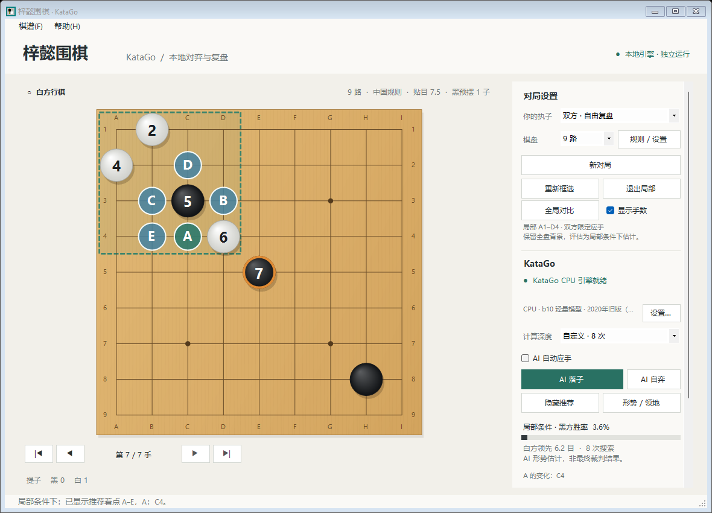
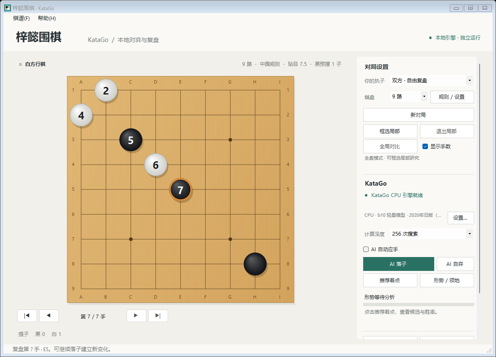

# 梓懿围棋

**致敬六大至尊围棋王“梓”和“懿”。**

梓懿围棋是可离线运行的 Windows 围棋对弈与复盘工具，使用本机 KataGo 计算着法。当前版本 **1.6.0** 增加框选局部研究、全局对比和棋子手数显示，保留双向让子、CUDA、OpenCL、CPU 和带日期的模型选择。已有 v1.4.0 / v1.5.0 GPU 便携包的用户可直接应用升级包；GPU 引擎、运行库和模型沿用 v1.4.0。

[下载最新版本](https://github.com/vict1238/ziyi-weiqi/releases/latest) · [版本记录](CHANGELOG.md) · [使用说明](使用说明.txt)



## 下载与运行

需要 **Windows 10 / 11 x64、.NET Framework 4.8**。

| 下载 | 用途 |
| --- | --- |
| [v1.6.0 升级包](https://github.com/vict1238/ziyi-weiqi/releases/download/v1.6.0/ziyi-weiqi-Windows-Update-v1.6.0.zip) | 主程序、说明与许可；解压到原程序目录，覆盖同名文件 |
| [v1.6.0 CPU 单文件程序](https://github.com/vict1238/ziyi-weiqi/releases/download/v1.6.0/ziyi-weiqi-v1.6.0.exe) | 内置轻量 CPU 引擎与 b10 模型，可直接运行 |
| [v1.6.0 完整源码](https://github.com/vict1238/ziyi-weiqi/releases/download/v1.6.0/ziyi-weiqi-source-v1.6.0.zip) | 源码、CPU 资源与固定版本 GPU 准备脚本 |
| [v1.6.0 SHA-256 校验清单](https://github.com/vict1238/ziyi-weiqi/releases/download/v1.6.0/SHA256SUMS.txt) | 核对本版三个发布文件 |
| [v1.4.0 CUDA / OpenCL 基础包](https://github.com/vict1238/ziyi-weiqi/releases/download/v1.4.0/ziyi-weiqi-Windows-CUDA-v1.4.0.zip) | 新 GPU 用户先下载：包含两种 GPU 引擎、最强 tf3、原 b18 与 CUDA 运行库 |

**已有 v1.4.0 完整 GPU 包，或已升级到 v1.5.0**：关闭梓懿围棋，将 v1.6.0 升级包内文件解压到原来的 `梓懿围棋.exe` 所在目录并覆盖同名文件，再运行更新后的程序。保留原有的 `cuda`、`gpu` 文件夹，无需重新下载引擎或模型。

**首次使用 GPU**：先下载并解压上表的 v1.4.0 基础包，再将 v1.6.0 升级包内文件解压到同一程序目录并覆盖，最后运行 `梓懿围棋.exe`。本版提供升级包，GPU 依赖继续使用相同的 v1.4.0 基础包。

完整包中的 `cuda`、`gpu` 文件夹须与主程序相邻，两个 GPU 后端共用 `gpu/models`。CUDA 运行库已随包提供，**无需安装完整 CUDA Toolkit**；仍需兼容的 NVIDIA 显卡和驱动。其他显卡可选择 OpenCL，首次加载模型或棋盘尺寸时可能调优数分钟。准备完成后，下棋无需联网或账号。

完整包首次运行检测到 NVIDIA 且 CUDA 引擎存在时默认 CUDA，否则使用可用的 OpenCL 或 CPU；GPU 默认最强 tf3 模型。旧版内置 GPU 配置升级时会在适用机器上迁移到 CUDA，保留已选模型；新版明确选择的后端、模型和自定义文件会保留。可在右侧“设置…”或“帮助 → 引擎 / 模型设置”选择 CUDA、OpenCL、CPU 或自定义程序。确认切换时保留棋局并取消旧分析，取消对话框则保留原配置。

Windows 智能应用控制可能阻止未获信任的引擎，程序会显示具体错误及处理提示。应用不会更改系统安全设置；也可在设置中主动选择 OpenCL 或 CPU。

## 功能

- 人执黑、执白、AI 自动应手、AI 自弈及双方自由复盘。
- 9 / 13 / 19 路棋盘、中国 / 日本规则与独立贴目设置。
- 双向 0–9 子让子：“白让黑”由黑棋先摆、白方先行；“黑让白”由白棋先摆、黑方先行。0 为分先，1 子放天元，2–9 子按标准星位摆放；在“规则 / 设置”确认后点“新对局”生效。
- 棋盘列连续编号；19 路为 **A–S（包含 I）**，行从顶部 **1** 到底部 **19**。落子、复盘、推荐和进度中的坐标一致。
- 框选局部研究，双方搜索和实际棋子落点限定在框内，保留整盘背景；可单次全局对比，研究框继续保留。
- 推荐着点 A–E、A 的最多 10 步变化、黑方胜率、目差及领地归属估计，搜索时实时更新。
- 可勾选“显示手数”，在当前存活棋子上显示其原始落子序号，随提子、悔棋、导航和新分支更新。
- 悔棋、停一手、逐手回看、SGF 主变化及初始摆子导入导出。
- 兼容野狐 SGF 贴目编码，识别转换时在状态栏说明；贴目范围为 −150 至 150，支持整数与半目。
- CUDA / OpenCL / CPU / 自定义本地 KataGo 与模型设置，切换时保留棋局、取消旧分析。
- 棋子落盘音效；在“规则 / 设置”中调节 0–100% 音量并试听，确认后生效。

默认 19 路、人执黑、AI 自动应手。方向键切换前后手，`Home` / `End` 跳到首手 / 末手，`Ctrl+O` / `Ctrl+S` 打开 / 保存棋谱。回看中落子会覆盖当前位置之后的变化。

## 局部研究与棋子手数

点击“框选局部”，按住左键在棋盘上拖出研究范围。框选不会落子；`Esc` 取消本次框选并保留原研究框。框内保留原棋局的轮次、规则、贴目和劫历史，框外棋子仍参与全盘局面评估。

进入局部研究后，人和 AI 的实际棋子落点以及黑白双方的搜索着法均限定在框内。点击“推荐着点”查看 A–E 候选和 A 的变化，最多显示 10 步，较短的变化按引擎实际返回显示。范围内没有当前方的合法落点时，程序提示扩大范围或退出局部，不会自动脱先或停一手。

先得到局部推荐，再点“全局对比”，可对照局部 A 与全局 A 的坐标。全局对比仅做一次全盘分析，不自动落子，也不清除研究框；下一次 AI 落子或局部分析仍使用原范围。“退出局部”恢复全盘对弈。新对局和导入 SGF 会清除研究框，复盘导航则保留它。

局部推荐是神经网络与有限搜索在限定应手条件下的建议，不保证数学意义的最优解，也不等同于全局最佳着法。征子、劫争和向外逃出的变化可能需要扩大研究范围；全局对比可帮助判断是否应在实战中脱先。

勾选“显示手数”后，当前存活棋子显示原始第 N 手。停一手计入总手数但没有棋子编号，开局预摆的让子或 SGF 摆子不编号；被提棋子的编号随之消失，同一点重新落子显示新手数。悔棋、复盘导航和建立新分支时，编号随当前局面恢复。



## 联机对弈

当前程序使用本地 KataGo，“双方 · 自由复盘”表示同一台电脑操作黑白。公网人对人对弈需要新增房间服务器、玩家身份、落子同步与断线恢复服务；实现方案见 [联机设计](docs/ONLINE-PLAY.md)。

## 本版验证

本版检查覆盖局部范围与当前复盘前缀、合法着与劫、双方搜索限制、候选及变化范围、全局对比和棋子手数，并保留规则、SGF、搜索预算、配置、声音与双向让子检查。具体断言数量、界面检查及真实 CPU / CUDA 引擎结果见 [验证记录](验证记录.txt)。下方性能表沿用 v1.4.0 的 36 次正式对比。

## 模型与计算量

| 模型 | 日期 | 用途 |
| --- | --- | --- |
| `kata1-tf3-b11c768-s11003M-d5973M-7gres` | 2026-09-25，官方上传日期 | 完整 GPU 包默认；约 7044 万参数的 Transformer |
| `kata1-b18c384nbt-s9996604416-d4316597426` | 2024-05-26，官方上传日期 | 保留的旧版 GPU 模型；约 2633 万参数 |
| `g170e-b10c128-s1141046784-d204142634` | 2020 年旧版；2020-11-28 官方收录 | 保留的内置 CPU 轻量模型；约 299 万参数 |
| 自定义文件 | 以文件提供者说明为准 | 选择本地 KataGo `.exe` 与 `.bin.gz` / `.bin`，版本需兼容 |

CUDA 和 OpenCL 均使用 KataGo 1.18.1；CUDA 配套 CUDA 12.1 / cuDNN 9.8，内置 CPU 使用 KataGo 1.14.1 Eigen。最强模型的名称、日期与选择依据来自 [KataGo 官方模型榜](https://katagotraining.org/networks/)；这是固定在本版本中的模型，不会联网自动更换。GPU 日期为公开上传时间；旧 g170 的具体训练完成日未记录，列出的是官方目录收录日期。

棋力取决于模型质量和搜索预算。**256 次搜索是访问次数（visits），不是向后推演 256 手，也不对应人类段位。** GPU 提高计算吞吐量；模型与访问次数相同时，硬件加速本身不会升级模型能力。

预设搜索次数为 **256 / 1024 / 2048 / 4096 / 8192 / 16384**，启动时 GPU 默认 **2048 次**，CPU 默认 **256 次**；同一会话切换后端或模型会沿用当前搜索预算。更大的模型和搜索量会增加思考时间，运行中可手动结束并采用当前最佳结果。自定义支持正整数，单次原生范围为 **1 至 1,125,899,906,842,624（2⁵⁰）**，越界会明确提示。持续思考使用原生 2⁵⁰ 搜索预算，由用户手动结束，计数仍然有限。

RTX 4060 Laptop GPU、8 GB、驱动 610.88，使用同一个最强 tf3 模型和相同设置：三个 19 路局面各测两轮，共 36 次正式查询。每次查询前清空神经网络缓存，启动和预热另计；下表为各档六次测量的中位数。

| 搜索次数 | OpenCL | CUDA | 耗时中位数之比 |
| --- | --- | --- | --- |
| 1024 | 6.90 秒 | 2.18 秒 | 3.17 倍 |
| 2048 | 13.16 秒 | 4.28 秒 | 3.07 倍 |
| 4096 | 25.03 秒 | 7.70 秒 | 3.25 倍 |

2048 为本版 GPU 日常对弈默认值；4096 及更高预算适合愿意等待更充分分析的情况。后台游戏、功耗和温度会影响耗时；加速倍数不是棋力倍数。[完整计时验证](qa/cuda-comparison.txt)

“结束思考并落子”采用当前最佳着法；“结束分析”保留当时的推荐或领地结果。分析不设置固定时长；新局、悔棋、棋谱导航、切换引擎和关闭程序会取消对应计算。胜率与领地为 AI 估计。

CPU 档案的程序和模型留空时使用内置资源；选择新模型时，请同时确认 KataGo 版本能读取它。GPU 与自定义档案会按所选文件启动，错误会显示在界面中供修正。

## 从源码构建

Windows 需提供 .NET Framework 4.8 和 `Framework64\v4.0.30319\csc.exe`。项目不依赖 NuGet 包。在根目录运行：

```powershell
.\build.ps1
.\prepare-gpu.ps1
.\prepare-cuda.ps1
```

主程序输出到 `release\梓懿围棋-v1.6.0\梓懿围棋.exe`。后两步分别准备 OpenCL / 模型与 CUDA 运行库，输出到相邻的 `gpu`、`cuda` 目录；下载固定官方版本并核验长度与 SHA-256，同时保留许可。默认下载缓存为 `%LOCALAPPDATA%\GoDesk\downloads`，已有缓存可复用：

```powershell
.\prepare-gpu.ps1 -SourceCache 'D:\KataGo-downloads'
.\prepare-cuda.ps1 -SourceCache 'D:\KataGo-downloads'
```

源码包含 CPU 资源；GPU 引擎、约 262 MB 的最强模型和约 98 MB 的旧 b18 模型由准备脚本获取。两个模型以原始名称保存在 `gpu/models`，清单 `gpu/runtime.json` 记录日期、来源和校验值。`-Destination` 可指定 GPU 输出目录。

执行规则、SGF、显示坐标、局部研究、棋子手数、配置及真实 CPU 引擎检查：

```powershell
.\build.ps1 -Checks
Start-Process -FilePath '.\release\梓懿围棋-v1.6.0\梓懿围棋.exe' `
  -ArgumentList '--ui-test', '.\qa\ui-test.txt' -WindowStyle Hidden -Wait
Get-Content .\qa\ui-test.txt
```

检查报告与截图写入 `qa`。引擎缓存、配置和日志位于 `%LOCALAPPDATA%\GoDesk`；引擎选择保存在 `engine-settings.json`，音量保存在 `audio-settings.json`。

## 目录与许可

```text
src/                    桌面界面、棋盘、围棋规则、SGF、引擎与检查
engine-assets/          内置 CPU 引擎、g170 模型及原始许可
gpu-licenses/           GPU 引擎、kata1 模型与依赖的原始许可
cuda-licenses/          NVIDIA 运行库许可与分发说明
examples/               示例 SGF
qa/                     验证报告与截图
build.ps1               Windows 构建与检查
prepare-gpu.ps1         固定版本 GPU 下载、校验与准备
prepare-cuda.ps1        固定版本 CUDA 运行库与引擎准备
```

应用源码采用 [MIT 许可](LICENSE.txt)。CPU g170 模型采用 CC0；GPU kata1 的 tf3 与 b18 模型采用带保留声明要求的 KataGo Neural Network License。NVIDIA 运行库受其专有许可约束，应用的 MIT 许可不替代这些条款。完整说明见 [第三方说明](THIRD-PARTY.md)、[CPU 许可](engine-assets/licenses)、[GPU 许可](gpu-licenses) 与 [CUDA 许可](cuda-licenses)。

感谢 [KataGo](https://github.com/lightvector/KataGo) 提供引擎与开放模型。本项目的棋盘与侧栏布局受到 [KataGui](https://github.com/hauensteina/katagui) 启发，桌面界面与规则代码独立编写。历史版本见 [1.1.0 发布](https://github.com/vict1238/ziyi-weiqi/releases/tag/v1.1.0)。
