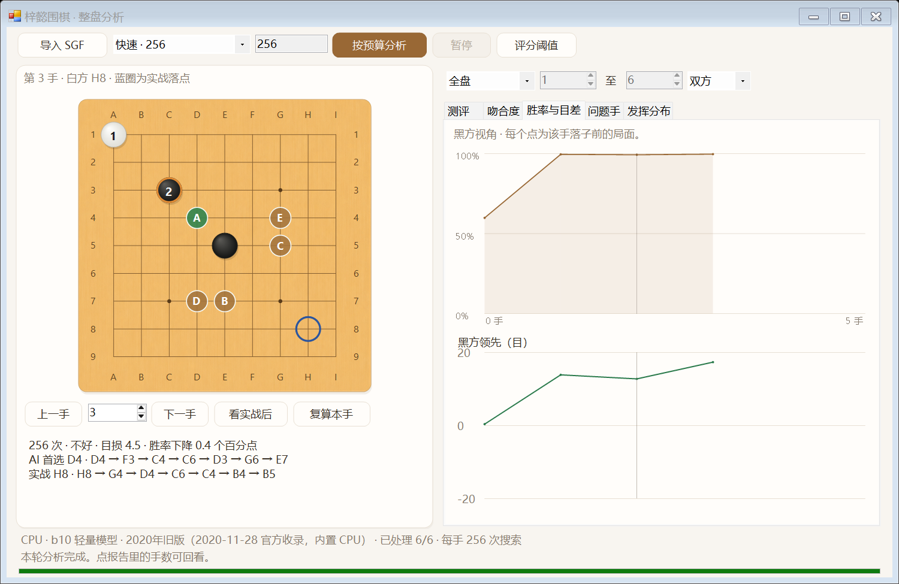

# 梓懿围棋

致敬六大至尊围棋王“梓”和“懿”。

Windows 围棋软件。和 KataGo 下棋，导入 SGF 逐手复盘，或约朋友联机摆棋。

## 下载

适用于 Windows 10 / 11 x64，需 .NET Framework 4.8。

| 你要做什么 | 下载与安装 |
| --- | --- |
| 直接运行 | [下载 v2.0.0 单文件版](https://github.com/vict1238/ziyi-weiqi/releases/download/v2.0.0/ziyi-weiqi-v2.0.0.exe)。内置 CPU 引擎，也能联机。 |
| 升级已有 GPU 版 | [下载 v2.0.0 升级包](https://github.com/vict1238/ziyi-weiqi/releases/download/v2.0.0/ziyi-weiqi-Windows-Update-v2.0.0.zip)。退出旧版，解压覆盖原目录，保留 `cuda` 和 `gpu`。 |
| 第一次用显卡 | 先解压 [v1.4.0 GPU 基础包](https://github.com/vict1238/ziyi-weiqi/releases/download/v1.4.0/ziyi-weiqi-Windows-CUDA-v1.4.0.zip)，再把 v2.0.0 升级包覆盖到同一目录。 |

[所有发布](https://github.com/vict1238/ziyi-weiqi/releases) · [版本记录](CHANGELOG.md) · [文件校验](SHA256SUMS.txt)

## 上手

- **对局**支持 9、13、19 路、中国和日本规则、双向让子，也可框选一角研究。
- **联机**支持局域网和 Tailscale。切磋房按黑白轮流落子，研讨房可一起摆棋、试下和共享 AI 推荐。
- **整盘分析**打开 SGF 后计算目损、吻合度、恶手率和胜率走势。点问题手回到落子前，再看推荐或加深复算。
- **截图识别**把棋盘截图或照片导入为摆子局面。识别后可手动校正，再继续下棋。

[使用说明](使用说明.txt) · [好友房与复盘口径](docs/ONLINE-PLAY.md)

## 从源码构建

在 Windows 项目根目录运行 `.\build.ps1`。需要 .NET Framework 4.8 和系统自带的 64 位 C# 编译器。程序输出到 `release/梓懿围棋-v2.0.0/`。运行 `.\build.ps1 -Checks` 可检查规则、棋谱和 CPU 引擎。构建 GPU 版时，再运行 `.\prepare-gpu.ps1` 和 `.\prepare-cuda.ps1`。

[测试记录](验证记录.txt) · [CUDA 测速数据](qa/cuda-comparison.txt) · [MIT 许可](LICENSE.txt) · [第三方许可](THIRD-PARTY.md)

围棋引擎来自 [KataGo](https://github.com/lightvector/KataGo)。早期界面布局参考 [KataGui](https://github.com/hauensteina/katagui)。
