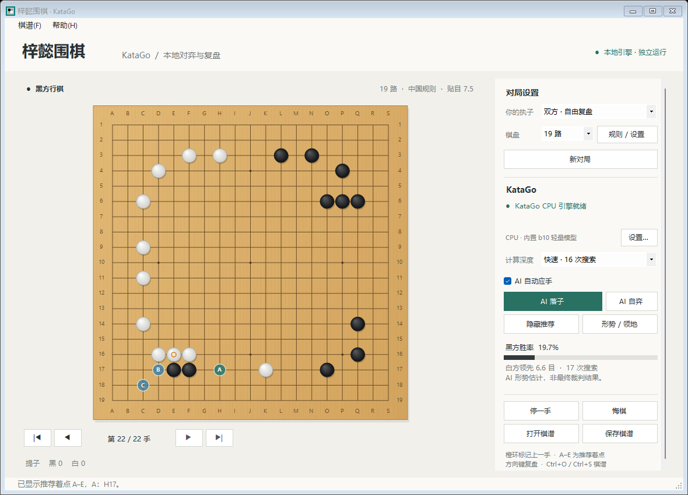

# 梓懿围棋

**致敬六大至尊围棋王“梓”和“懿”。**

梓懿围棋是可离线运行的 Windows 围棋对弈与复盘工具，使用本机 KataGo 计算着法。当前版本 **1.2.0** 支持 GPU / CPU 引擎与本地模型选择。

[下载最新版本](https://github.com/vict1238/ziyi-weiqi/releases/latest) · [版本记录](CHANGELOG.md) · [使用说明](使用说明.txt)



## 下载与运行

需要 **Windows 10 / 11 x64、.NET Framework 4.8**。

| 下载 | 用途 |
| --- | --- |
| [GPU 完整便携包](https://github.com/vict1238/ziyi-weiqi/releases/download/v1.2.0/ziyi-weiqi-Windows-GPU-v1.2.0.zip) | 含 OpenCL 引擎、b18 模型及全部运行依赖；解压后运行 `梓懿围棋.exe` |
| [CPU 单文件程序](https://github.com/vict1238/ziyi-weiqi/releases/download/v1.2.0/ziyi-weiqi-v1.2.0.exe) | 内置轻量 CPU 引擎与 b10 模型，可直接运行 |
| [完整源码](https://github.com/vict1238/ziyi-weiqi/releases/download/v1.2.0/ziyi-weiqi-source-v1.2.0.zip) | 源码、CPU 资源与 GPU 下载准备脚本 |
| [SHA-256 校验清单](https://github.com/vict1238/ziyi-weiqi/releases/download/v1.2.0/SHA256SUMS.txt) | 核对下载文件 |

GPU 包的 `gpu` 文件夹须与主程序相邻。OpenCL 使用显卡厂商驱动提供的计算支持，**无需安装 CUDA**；首次运行新模型或棋盘尺寸时，调优可能需要几分钟。完成准备后，下棋无需联网或账号。

未保存引擎设置时，完整 GPU 包默认选择 GPU；CPU 单文件默认选择内置 CPU。已保存的设置优先。可在右侧“设置…”或“帮助 → 引擎 / 模型设置”中确认当前后端与模型。

## 功能

- 人执黑、执白、AI 自动应手、AI 自弈及双方自由复盘。
- 9 / 13 / 19 路棋盘，中国 / 日本规则、贴目和让子。
- 棋盘列连续编号；19 路为 **A–S（包含 I）**，行从顶部 **1** 到底部 **19**。落子、复盘、推荐和进度中的坐标一致。
- 推荐着点、黑方胜率、目差及领地归属估计，搜索时实时更新。
- 悔棋、停一手、逐手回看、SGF 主变化及初始摆子导入导出。
- 兼容野狐 SGF 贴目编码，识别转换时在状态栏说明；贴目范围为 −150 至 150，支持整数与半目。
- CPU / GPU / 自定义本地 KataGo 与模型设置，切换时保留棋局、取消旧分析。
- 棋子落盘音效；在“规则 / 设置”中调节 0–100% 音量并试听，确认后生效。

默认 19 路、人执黑、AI 自动应手。方向键切换前后手，`Home` / `End` 跳到首手 / 末手，`Ctrl+O` / `Ctrl+S` 打开 / 保存棋谱。回看中落子会覆盖当前位置之后的变化。

## 模型与计算量

| 档案 | 引擎与模型 |
| --- | --- |
| 内置 CPU | KataGo 1.14.1 Eigen；g170 b10c128 轻量模型，2020 年 |
| GPU 套件 | KataGo 1.18.1 OpenCL；`kata1-b18c384nbt-s9996604416-d4316597426`，18 层、384 通道、嵌套瓶颈结构，2024-05-26 |
| 自定义 | 选择本地 KataGo `.exe` 与 `.bin.gz` / `.bin` 模型；两者版本需兼容 |

棋力取决于模型质量和搜索预算。**256 次搜索是访问次数（visits），不是向后推演 256 手，也不对应人类段位。** GPU 提高计算吞吐量；模型与访问次数相同时，硬件加速本身不会升级模型能力。GPU 可先尝试自定义 **4096 次**，再按实际耗时调整。

快速 / 标准 / 深入仍为 **16 / 64 / 256 次**。自定义支持正整数，单次原生范围为 **1 至 1,125,899,906,842,624（2⁵⁰）**，越界会明确提示。持续思考使用原生 2⁵⁰ 搜索预算，由用户手动结束，计数仍然有限。

“结束思考并落子”采用当前最佳着法；“结束分析”保留当时的推荐或领地结果。分析不设置固定时长；新局、悔棋、棋谱导航、切换引擎和关闭程序会取消对应计算。胜率与领地为 AI 估计。

CPU 档案的程序和模型留空时使用内置资源；选择新模型时，请同时确认 KataGo 版本能读取它。GPU 与自定义档案会按所选文件启动，错误会显示在界面中供修正。

## 从源码构建

Windows 需提供 .NET Framework 4.8 和 `Framework64\v4.0.30319\csc.exe`。项目不依赖 NuGet 包。在根目录运行：

```powershell
.\build.ps1
.\prepare-gpu.ps1
```

主程序输出到 `release\梓懿围棋-v1.2.0\梓懿围棋.exe`，GPU 套件输出到相邻的 `gpu` 目录。第二步下载固定版本的官方引擎和模型，核验文件长度与 SHA-256，并保留完整 DLL 树与许可。默认下载缓存为 `%LOCALAPPDATA%\GoDesk\downloads`；已有缓存可复用：

```powershell
.\prepare-gpu.ps1 -SourceCache 'D:\KataGo-downloads'
```

源码包含 CPU 资源；GPU 引擎和约 98 MB 模型由准备脚本获取。`-Destination` 可指定 GPU 输出目录。

执行规则、SGF、显示坐标、配置及真实 CPU 引擎检查：

```powershell
.\build.ps1 -Checks
Start-Process -FilePath '.\release\梓懿围棋-v1.2.0\梓懿围棋.exe' `
  -ArgumentList '--ui-test', '.\qa\ui-test.txt' -WindowStyle Hidden -Wait
Get-Content .\qa\ui-test.txt
```

检查报告与截图写入 `qa`。引擎缓存、配置和日志位于 `%LOCALAPPDATA%\GoDesk`；引擎选择保存在 `engine-settings.json`，音量保存在 `audio-settings.json`。

## 目录与许可

```text
src/                    桌面界面、棋盘、围棋规则、SGF、引擎与检查
engine-assets/          内置 CPU 引擎、g170 模型及原始许可
gpu-licenses/           GPU 引擎、kata1 模型与依赖的原始许可
examples/               示例 SGF
qa/                     验证报告与截图
build.ps1               Windows 构建与检查
prepare-gpu.ps1         固定版本 GPU 下载、校验与准备
```

应用源码采用 [MIT 许可](LICENSE.txt)。CPU g170 模型采用 CC0；GPU kata1 b18 模型采用带保留声明要求的 KataGo Neural Network License。引擎及依赖各自遵循原许可，见 [第三方说明](THIRD-PARTY.md)、[CPU 许可](engine-assets/licenses) 与 [GPU 许可](gpu-licenses)。

感谢 [KataGo](https://github.com/lightvector/KataGo) 提供引擎与开放模型。本项目的棋盘与侧栏布局受到 [KataGui](https://github.com/hauensteina/katagui) 启发，桌面界面与规则代码独立编写。历史版本见 [1.1.0 发布](https://github.com/vict1238/ziyi-weiqi/releases/tag/v1.1.0)。
